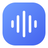

<p align="center"></p>

<h1 align="center">Anki Sound Capture</h1>

<p align="center"><strong>Capture a moment of system audio. Put it on an Anki note.</strong></p>

<p align="center">A small macOS menu-bar app for sentence mining and language study.</p>

Press a shortcut to record, press it again to stop, trim the waveform, and attach the clip to Anki.

## What it does

- Records system audio on demand, without recording your microphone.
- Previews and trims recordings with a waveform and playback cursor.
- Selects the latest note in your chosen deck, or lets you search for another.
- Appends audio to a configurable field; existing field content is never replaced.
- Optionally reduces loud peaks with bundled FFmpeg. Stable volume is off by default.
- Keeps Anki's open note editor in sync through a small companion add-on.

## Requirements

- macOS 14 or later.
- [Anki](https://apps.ankiweb.net/) with [AnkiConnect](https://ankiweb.net/shared/info/2055492159) installed (add-on code `2055492159`).
- Xcode command line tools for the build: `xcode-select --install`.
- Internet access for the first build, to download the pinned FFmpeg source.

## Install

1. Install AnkiConnect in Anki: **Tools → Add-ons → Get Add-ons**, enter `2055492159`, then restart Anki.
2. In Terminal:

   ```sh
   git clone https://github.com/lexlexlexdev/anki-sound-capture.git
   cd anki-sound-capture
   ./install.sh
   ```

3. Restart Anki again to load the **Anki Audio Capture Sync** companion add-on installed by the script.
4. Open **Anki Audio Capture** from `~/Applications`. Find the waveform icon in the menu bar.
5. Grant screen-recording access when prompted. The app captures audio only; it does not save screen video.

If your Anki data is stored outside the default location, run `ANKI_BASE=/path/to/Anki2 ./install.sh` instead.

## Use

1. Press **⌃⌥⌘9** to start recording; press it again to stop. Change the shortcut in the menu-bar app's **Settings**.
2. Drag the waveform handles to trim. Preview the selection and optionally turn on **Stable volume**.
3. Check the note and field, or search for a different note. Choose **Attach to note**.

The default deck, note-type fields, and Stable volume preference are in **Settings**. Anki and AnkiConnect must be running when attaching. The chosen field must appear in the relevant card template to be visible or playable during review.

> Start playback at a low system volume. Peak limiting cannot guarantee a safe listening level.

## Privacy and storage

Recording starts only when requested. Audio is processed locally. Saved clips are stored in your Anki profile's `collection.media` folder and sync through Anki when media sync is enabled. Temporary preview files are removed after attachment or discard. AnkiConnect listens locally at `127.0.0.1:8765`.

## Build and test

```sh
./build.sh
swift test
python3 -m unittest discover -s Tests/AnkiSyncTests -v
```

The app is created at `build/Anki Audio Capture.app`. The build creates a minimal FFmpeg from pinned source and bundles it; FFmpeg is not required at runtime. On a clean machine this first build takes longer.

The build uses the first available Apple Development signing identity, or an ad-hoc signature if none is available. Set `CODE_SIGN_IDENTITY` to choose one explicitly (`CODE_SIGN_IDENTITY=- ./build.sh` for ad-hoc signing). Ad-hoc signed rebuilds can require screen-recording permission to be granted again. This project does not provide a notarized build.

## License

App and companion add-on: [MIT](LICENSE). Bundled FFmpeg is separately licensed under LGPL 2.1 or later; see [third-party notices](THIRD_PARTY_NOTICES.md).
